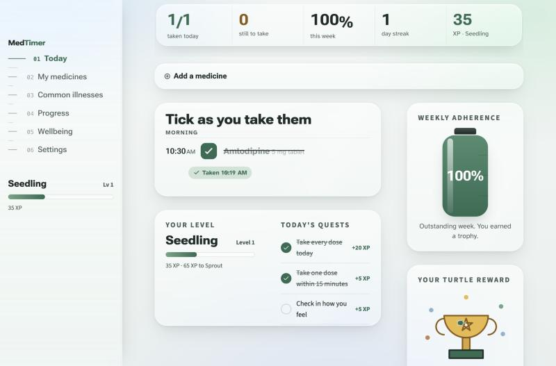
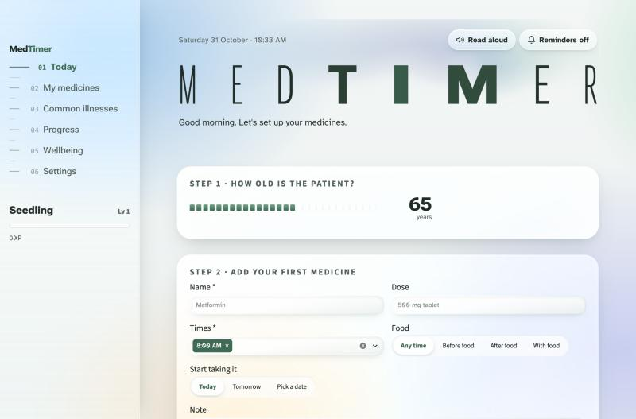
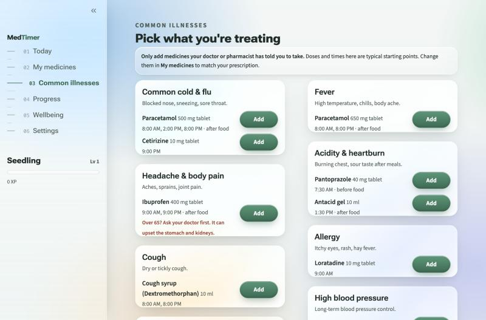

# MedTimer: Daily Medicine Companion

> A calm, senior-friendly web app that helps people with long-term conditions take the right
> medicine at the right time, built with **Python + Streamlit**.

**Live app:** (https://id1000672kavishpratikshahsa-1-python-ashuwpzsrfwsfek6dradqy.streamlit.app/) ← 

| | |
|---|---|
| **Course** | Python Programming, Summative Assessment (CRS: Artificial Intelligence) |
| **Scenario** | Scenario 2: Design MedTimer Daily Medicine Companion using Python |
| **Student** | *Your full name*, *Candidate registration number* |



**Contents:** 1 Overview · 2 Features · 3 Screenshots · 4 Planning & design · 5 How the Python works ·
6 Integration · 7 Run locally · 8 Deployment · 9 Testing · 10 Ethics · 11 Credits

---

## 1. Project overview

Many older adults take several medicines a day and often can't remember whether a dose was already
taken. MedTimer turns that daily worry into a calm checklist you tick off:

* **Green** = taken, **Yellow** = upcoming / due now, **Red** = missed
* A **weekly adherence score** shown as liquid filling a medicine bottle
* A **turtle-graphics reward** (trophy, smiley or seedling) drawn stroke by stroke
* **Before / after food** guidance and a **start date** on every medicine
* A **Common illnesses** library with typical medicines you can add in one tap
* **Gamified**: XP for every dose, plant-themed levels, daily quests and badges
* **Tips, a daily quote and a mood check-in** keep it encouraging, never clinical

## 2. Key features

| Brief requirement | How MedTimer does it |
|---|---|
| Add / edit / delete daily medicines | Name, dose, any number of times per day, **before / after / with food**, a **start date** (today, tomorrow or any date), a note. Friendly validation; deleting asks "are you sure?". The app starts empty, so each user sets up their own list. |
| Live checklist, colour-coded | Big tick boxes grouped Morning / Afternoon / Evening / Night. Each dose has a status chip with **icon + words + colour** (never colour alone), updated against the real clock in the user's time zone. |
| Weekly adherence score | Taken ÷ due over the last 7 days, shown in the header, as a liquid "medicine bottle" and as a bar chart. |
| Turtle drawing on good adherence | Trophy at 90%+, smiley at 80%+, an encouraging seedling below that, drawn live with turtle commands. |
| Tips / motivational quotes | Thought for the day, a folder of 8 tips that float out, and a new tip after every dose. |
| Layout from the brief | *Today*: "Add a medicine" panel at the top, the live checklist below it, weekly score bottle and turtle on the side. |
| *Optional:* downloadable report | *Progress → Share report*: a printable page (Print → Save as PDF) with score, medicines, food rules, start dates and day-by-day results. |
| *Optional:* audio alert | "Reminders" plays a gentle chime and speaks the medicine name at each dose time. |
| *Optional:* user-defined reminders | Settings: chime on time or 5 / 10 / 15 / 30 minutes early, and how long after the planned time a dose turns red. |

### What makes it stand out
* **Apple-style liquid glass design**: frosted, see-through panels with a rim of light over slowly drifting colours,
  frosted text boxes, a glass sidebar, glossy pill buttons and a glass medicine bottle.
* **Satisfying check-off**: a spring fills the box, draws the tick, strikes through the name, and sparks fly with a "+15 XP" pop.
* **Game layer**: +10 XP per dose, +5 for taking it on time, +20 for a perfect day, +5 for the mood check-in. Levels grow like a plant
  (Seedling, Sprout, Sapling, Blossom, Evergreen, Mighty Oak, Ancient Forest), with three daily quests and a level-up celebration.
* **Common illnesses**: cold & flu, fever, pain, acidity, cough, allergy, diabetes, blood pressure, cholesterol, thyroid,
  vitamin D and constipation, each with typical medicines, times and food rules, added in one tap and fully editable.
* **Age-aware**: a slider asks the patient's age; from 65 some medicines (e.g. Ibuprofen) show an extra caution.
* **Read aloud** in a soft, friendly voice: one tap and the browser speaks today's whole schedule, including food rules.
* **Safety rules**: a dose can't be ticked more than 60 minutes early, and a late dose comes with "don't double your next dose" advice.
* **Accessibility**: Atkinson Hyperlegible font (made for low vision), large touch targets, keyboard and screen-reader
  labels, and animations switch off with the device's "reduce motion" setting. Text colours meet WCAG AA (body text 12.9:1).
* **Privacy by design**: no account, no server database; data stays in the browser session.

## 3. Screenshots

| First run | Common illnesses |
|---|---|
|  |  |

---

## 4. Planning & design (Stage 1)

### Who is the app for?

| | |
|---|---|
| **Primary user** | Adults aged 60+ who take 2 to 6 medicines a day for long-term conditions (diabetes, blood pressure, cholesterol). |
| **Secondary user** | A family member or carer who helps set the app up and checks the weekly progress. |
| **Also** | The user's doctor or pharmacist, who receives the shared report. |

**Persona: "Asha, 68".** Retired teacher with type 2 diabetes and high blood pressure. Takes Metformin twice a day,
Amlodipine every morning and a statin at night. Uses WhatsApp and video calls, but finds small buttons, grey text and
busy screens hard. *"I never know if I already took the morning one, so sometimes I skip it to be safe."*

**Pain points:** forgetting whether a dose was taken; unclear schedules with several medicines; anxiety and guilt after
a missed dose; small, low-contrast, cluttered apps; reporting to the doctor from memory.

**Feelings we want to create:** comfort, trust and empowerment. A calm companion, never a nagging alarm. Missed doses
are shown honestly (red) but the language is always kind ("Let's start fresh today").

### Design principles
1. **One theme everywhere**: header, title, checklist and charts share the same colours, so the app feels like one calm object.
2. **Fewer words**: one sentence in the header; numbers and tick boxes instead of paragraphs.
3. **One obvious action**: on Today, the main thing to do is tick a box.
4. **Kind by default**: encouraging copy and a growing seedling, never a red "fail".

| Decision | Why |
|---|---|
| **Atkinson Hyperlegible**, 18 px+ | Designed by the Braille Institute for low-vision readers; `I l 1` and `0 O` are easy to tell apart. |
| **Roboto Flex** for headings and the title | A variable font: the title's letters swell in weight and width near the pointer. |
| **Calm blue-and-green palette** with liquid glass | Soft and natural; every text colour passes WCAG AA. |
| **Traffic-light status** with icon + word + colour | Required by the brief, and never colour alone, for colour-blind users. |
| Tick boxes **40 px**, buttons **48 px** tall | Easier for shaky hands. |
| **12-hour clock** ("8:00 AM") | More familiar for most older adults than "08:00". |
| Doses **grouped by Morning / Afternoon / Evening / Night** | Matches how people think about their day. |

| Colour | Hex | Use | Contrast |
|---|---|---|---|
| Ink | `#1E2B26` | Main text, title | 12.9:1 |
| Ink 2 | `#4F5F58` | Secondary text | 5.9:1 |
| Green (taken / accent) | `#2F6B52` | Buttons, ticks, "Taken" | 5.5:1 |
| Yellow (upcoming / due) | `#8A5B12` on `#FBF1D6` / `#5C3D0A` on `#F2D27A` | "In 2h", "Due now" | 5.1:1+ |
| Red (missed) | `#A23B30` on `#F4DAD5` | "Missed" | 5.8:1 |
| Backdrop | `#EEF3F1` + soft blue, mint, lilac, peach | Behind the glass | – |

### Wireframe
```
+-----------+----------------------------------------------------------------+
| MedTimer  | Saturday 31 October · 10:33 AM      ( Read aloud ) ( Reminders ) |
|           |  M  E  D  T  I  M  E  R   <- letters swell near the mouse      |
| 01 Today  |  Good morning. Amlodipine is due now.                          |
| 02 My     |  [ 1/3 taken | 2 to take | 94% week | 3 day streak | 120 XP ]  |
|  medicines+----------------------------------------------------------------+
| 03 Common |  ( + Add a medicine )            <- inputs at the top          |
| illnesses +-----------------------------------------+----------------------+
| 04 Progr. |  Tick as you take them                  |  WEEKLY ADHERENCE    |
| 05 Well-  |  MORNING                                |     [ bottle 94% ]   |
|  being    |  8:00 AM [v] ~~Metformin~~ (Taken 8:19) |                      |
| 06 Sett.  |  9:00 AM [ ] Amlodipine    (Due now)    |  YOUR TURTLE REWARD  |
|           |  EVENING                                |   trophy / smiley /  |
| Sapling   |  8:00 PM [ ] Metformin  (In 10h, lock)  |   seedling, drawn    |
| [====  ]  +-----------------------------------------+   live               |
|           |  Your level [====]  |  Today's quests   |                      |
+-----------+-----------------------------------------+----------------------+
```

### Feature plan
**Must-have (compulsory), all done:** add / edit / delete medicines · live checklist of scheduled vs taken vs missed ·
green / yellow / red status · weekly adherence score · turtle drawing on good adherence · tips and quotes.

**Nice-to-have, all done:** audio alert and spoken reminder · user-defined reminder timing · downloadable report ·
read aloud · before / after food · start dates · common illnesses library · XP, levels, quests, badges, streaks ·
patient's age with cautions from 65 · daily mood check-in.

---

## 5. How the Python works (Stage 2)

All the logic lives in [`app.py`](app.py) as small, commented, testable functions, kept separate from the interface.

**Data structures**
```python
medicines = [   # list of dictionaries
    {"id": "a1b2c3d4", "name": "Metformin", "dose": "500 mg tablet", "times": ["08:00", "20:00"],
     "food": "After food", "notes": "", "start": "2026-10-24", "added": "2026-10-24", "from": "00:00"},
]
log   = {"2026-10-31": {"a1b2c3d4@08:00": "08:19"}}   # date -> {dose -> time taken}
moods = {"2026-10-30": "Good"}
```

**Rules**
* **Status of a dose** (compares the current time with the scheduled time): *taken* if it is in `log`; *upcoming*
  before its time; *due* within the grace window (default 60 min); *missed* after that.
* **Weekly adherence** = doses taken ÷ doses that were due, over the last 7 days. Upcoming doses are not counted,
  and doses before a medicine was added to the app are ignored, so a past start date never invents missed doses.
* **Turtle reward**: 90%+ trophy, 80%+ smiley, otherwise an encouraging seedling.
* **Safety**: a dose can only be ticked up to 60 minutes early; a missed dose can be logged late with a warning.

| Function | Job |
|---|---|
| `dose_status()` | Taken / upcoming / due / missed using `datetime` and the grace window |
| `build_checklist()` | Today's doses, sorted, each with its status |
| `too_early()` | Safety rule: no ticking more than 60 minutes ahead |
| `weekly_summary()` | Per-day and overall adherence for the last 7 days |
| `perfect_day_streak()` / `earned_badges()` | Streaks and simple, explainable badge rules |
| `xp_total()` / `level_for()` / `daily_quests()` | The game layer, all worked out from the dose history |
| `reward_level()` / `turtle_reward_svg()` | Picks and draws the turtle reward |
| `reminder_alarms()` | When to chime and what to say, with the user's chosen lead time |
| `build_report_html()` | The shareable report for a doctor or family |
| `validate_medicine()` | Friendly form errors (empty name, no time, duplicate) |

**Turtle graphics.** Python's `turtle` module needs a desktop window (tkinter), which does not exist on
Streamlit Cloud. So `SvgTurtle` provides the **same turtle commands** (`forward`, `left`, `circle`,
`begin_fill`, `dot`, `write` …), uses the same circle maths as CPython, and records the path as an
animated SVG. A little turtle follows the pen while it draws. The drawing functions (`draw_trophy`,
`draw_smiley`, `draw_seedling`) work with **both** `SvgTurtle` and the real `turtle.Turtle`:

```bash
python app.py --turtle trophy     # opens a real turtle window on your own computer
```

---

## 6. Integration details

| Part | Technology |
|---|---|
| App framework | Streamlit 1.66 (columns, containers, toasts, download button, `st.context.timezone`) |
| Data / charts | pandas, Altair (colour-coded bar chart with labels and an 80% target line) |
| Dates and time zones | `datetime`, `zoneinfo` (the browser's time zone is detected automatically) |
| Animated UI | Components from **[React Bits](https://reactbits.dev)**, rewritten in plain JavaScript so no Node build is needed: **LineSidebar** (navigation), **SpringCheck** (checklist) with a **ClickSpark**-style burst, **WakeSlider** (age), **Aurora** (header glow, WebGL), **TextPressure** (title), **Counter** (rolling stats), **SloshGauge** (medicine bottle), **FolderFloat** (tips, matter-js physics), **OptionWheel** (mood). |
| Two-way components | A small HTML page kept inside `app.py` (`_WIDGETS_HTML`) speaks Streamlit's component message protocol, so the sidebar, checklist, age slider and mood wheel send values back to Python. It is written to a temporary folder at start-up, so there are no extra files to upload. |
| Fonts | Atkinson Hyperlegible (text) and Roboto Flex (display) |
| Browser APIs | Web Speech API (read aloud), Web Audio API (chime) |

### Project structure
```
MedTimer/
├── app.py                # everything: logic, turtle graphics, visual components, interface
├── test_app.py           # 26 automated tests (pytest)
├── requirements.txt
├── README.md
└── screenshots/
```

## 7. Run it locally

```bash
git clone https://github.com/YOUR-USERNAME/YOUR-REPO-NAME.git
cd YOUR-REPO-NAME
python -m venv .venv && source .venv/bin/activate      # Windows: .venv\Scripts\activate
pip install -r requirements.txt
streamlit run app.py
```

Run the tests: `pip install pytest && python -m pytest -q`

## 8. Deployment instructions (Streamlit Community Cloud)

1. Push this folder to a GitHub repository named like `IDAI102-<StudentID>-<StudentName>`.
2. Go to **https://share.streamlit.io** and sign in with GitHub.
3. Click **Create app → Deploy a public app from GitHub**.
4. Choose the repository, branch `main`, main file `app.py`, and pick an app URL.
5. Click **Deploy**. Streamlit installs `requirements.txt` and the app goes live in a minute or two.
6. Paste the live link at the top of this README and commit.

---

## 9. Testing (Stage 4)

### Automated tests
**26 tests** in [`test_app.py`](test_app.py) cover statuses at different times of day, the early-tick rule,
adherence maths, streaks, badges, XP and levels, daily quests, food timing, start dates, reminder timing, the report,
the common-illness library, turtle drawings, validation and the read-aloud text.

### Manual tests as a new user
| # | What I did | Expected | Result |
|---|---|---|---|
| 1 | Opened the app for the first time | Empty list; Step 1 age, Step 2 add a medicine | Pass |
| 2 | Dragged the age slider | Bars rise in a wake, value saved | Pass |
| 3 | Common illnesses → Add Paracetamol, Metformin | Both show "Added", toast shown | Pass |
| 4 | Ticked a dose | Box fills, tick draws, name strikes through, sparks and "+15 XP", stats and quests update | Pass |
| 5 | Un-ticked it | Returns to its earlier status, stats go back | Pass |
| 6 | Looked at a dose hours away | Lock icon, "In 9h 33m", can't be ticked | Pass |
| 7 | Added "metformin" twice | "Already in your list" error, typing kept | Pass |
| 8 | Added a medicine at 9:18 AM with an 8:00 AM time | Not counted as missed today | Pass |
| 9 | Added a medicine starting tomorrow | "Starts tomorrow", not on today's list | Pass |
| 10 | Age 65 on Common illnesses | Ibuprofen shows an over-65 caution | Pass |
| 11 | Progress page | Big score, bottle, colour-coded bars, badges, Share report | Pass |
| 12 | Wellbeing | Tips float out of the folder; mood wheel saves, +5 XP | Pass |
| 13 | Time zone from the browser | Correct local time in the header | Pass |

### Problems found and fixed
| Problem | Fix |
|---|---|
| A dose **hours away** could be logged by a stray tap. | Doses can only be ticked from 60 min before their time. |
| A medicine added mid-morning was immediately **counted as missed**. | Each medicine remembers when it was added; earlier doses are ignored. |
| The add form **cleared everything** when there was a mistake. | The form keeps what was typed until the medicine is saved. |
| "None" appeared under the turtle drawing. | A one-line `if/else` expression was being shown by Streamlit "magic"; rewritten as a normal `if`. |
| The tick animation was cut off. | Toasts and balloons were added above the page, shifting every element; they now go at the end. |
| "Upcoming" was grey, not yellow as the brief asks. | Upcoming chips are soft yellow, "Due now" a stronger yellow. |
| The stats bar wrapped and clipped labels on narrow screens. | It now stays on one row and shrinks to fit. |
| On Streamlit Cloud the app crashed loading the widgets, because the `frontend` folder was missing from the repository. | The widget page now lives inside `app.py` and is written out automatically at start-up. |

### Design reviews
| Feedback | Change |
|---|---|
| Looked pasted together: a black header on a light app, too much text | One calm theme; the title uses the page's ink; tick boxes instead of text-heavy cards |
| "Don't preload medicines, let me set them." | The app starts empty with a two-step setup (age, then medicines) |
| "Add common sicknesses with medicines." | Common illnesses page with one-tap Add and a safety note |
| "Tell me if it's before or after food." | Food option on every medicine, shown in the checklist and spoken aloud |
| "Let me choose when a medicine starts." | Start taking it: Today / Tomorrow / Pick a date |
| "Make it more fun." | XP, levels, daily quests, sparks and "+XP" on every tick |
| "Make it look like Apple's liquid glass." | Frosted, see-through panels, text boxes, buttons and sidebar |

### Feedback from real people
> **Student to complete:** show the app to one or two people from the target group (a grandparent,
> neighbour or family member) and write down what confused them and what you changed.

| Who (age) | What they said / where they got stuck | What I changed |
|---|---|---|
| | | |
| | | |

---

## 10. Ethics and responsibility

* MedTimer is a **memory aid, not medical advice**; this is stated in the app and on the Common illnesses page,
  which also says to only add medicines a doctor or pharmacist advised. Doses there are only starting points.
* It never tells users to double a dose and suggests asking a pharmacist about late doses.
* **No personal health data is sent to or stored on a server.**
* Gamification rewards taking medicine **as scheduled**, never taking extra: doses can't be ticked more than 60 minutes early.
* Kind wording avoids guilt: low scores show a growing seedling and "Let's start fresh today".
* Built for inclusion: large text, screen-reader labels, keyboard support, reduced motion.

## 11. Credits

UI component designs: [React Bits](https://reactbits.dev). Physics: [matter-js](https://brm.io/matter-js/).
Fonts: Google Fonts. Quotes are credited in the app.
